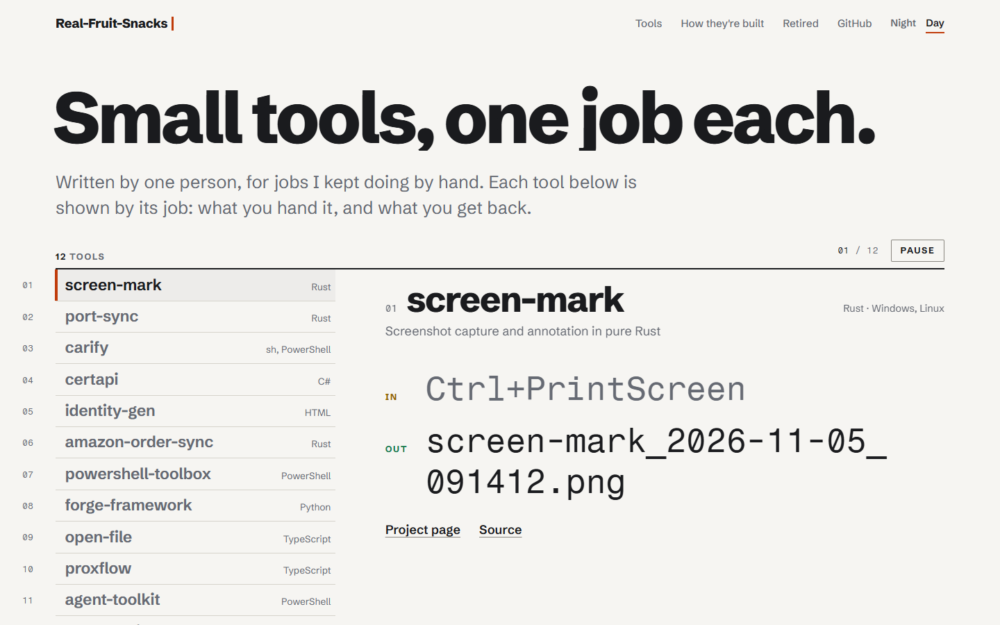

# real-fruit-snacks.github.io

The list of every tool I maintain, at **[real-fruit-snacks.github.io](https://real-fruit-snacks.github.io/)**. Each tool is shown by its job: what you hand it and what you get back. On the page an orange seam sweeps each job in turn.

<picture>
  <source media="(prefers-color-scheme: dark)" srcset="assets/readme/screen-dark.png">
  
</picture>

One static page served by GitHub Pages from `main`. No build step on the server, no framework, and nothing loaded from other sites: the fonts are in `fonts/`, the script is about 110 lines in `script.js`.

## Adding, renaming or retiring a tool

Edit `tools.json`, then write it into the page:

```sh
node scripts/build.mjs
```

That puts the list into `index.html` between the `<!-- build: -->` markers, so the page shows all of it without JavaScript. Commit both files. CI runs `node scripts/build.mjs --check --github`, which fails if `index.html` is out of date, if a listed repo is archived, private or missing on GitHub, or if a retired one isn't archived or is private (the page links to it). It runs weekly too, so a repo archived somewhere else shows up here.

Each entry in `tools.json`:

| Field | What |
|---|---|
| `repo` | The repo name under Real-Fruit-Snacks |
| `description` | GitHub's one-line description, about 60 characters, no period |
| `in`, `out` | The job, up to 40 characters each, quoted from what the tool really reads and writes. `` `backticks` `` set a part in mono |
| `language`, `platform` | Shown beside the name |
| `site` | The tool's project page; without one the row links to the repo |

`around` holds the repos that aren't tools (the brand, rfs.tools), and `retired` the archived ones. The same list is drawn into the [profile README](https://github.com/Real-Fruit-Snacks/Real-Fruit-Snacks) by its `art/make-board.py` and named in rfs-brand's `brand/org.toml`, so a change here goes there too.

## Tests

The tests cover `scripts/build.mjs`: every `tools.json` rule it enforces, what it writes between the build markers, `--check` on a current page and a stale one, CRLF and LF checkouts, unknown options and `--help`, and `--github` against a stand-in `gh`, so they never reach GitHub and need no token. `script.test.mjs` runs `script.js` against a stand-in browser (`fake-page.mjs`) to check that the board follows reduced motion when it's turned on or off with the page open. They use `node:test` and nothing else; Node 24, no install. From the repo's root:

```sh
cd tests
node --test
```

Each build test works on a copy of the script in a temporary folder, so `index.html` and `tools.json` are never touched. CI runs them on every push and pull request, in the `tests` job of `.github/workflows/check.yml`.

## Files

| File | What |
|---|---|
| `index.html`, `styles.css`, `script.js` | The page. Its design decisions are in [DESIGN.md](DESIGN.md) |
| `tools.json`, `scripts/build.mjs` | The list, and the script that writes it into the page |
| `tests/` | The tests for `scripts/build.mjs` and `script.js`, with the stand-in `gh` in `tests/stand-in/` |
| `fonts/` | Schibsted Grotesk and Fragment Mono, woff2, with their OFL licences |
| `card.html` → `assets/og.png` | The social preview. Render it with killer-repo's `card.mjs card.html --out assets/og.png`; keep the path, the page's `og:image` points at it |
| `scripts/mark.svg` | The favicon source. The icon files and `manifest.webmanifest` are built from it with killer-design's `icons.mjs build` |
| `assets/readme/` | The screenshots above: the first screen at 1440 × 900, three seconds after load |

Colours are the RFS Nightshift and Dayshift values from [rfs-brand](https://github.com/Real-Fruit-Snacks/rfs-brand/blob/main/BRAND.md). The theme follows the OS setting, and the Night/Day switch saves its choice as `rfs-theme`, the same key the other RFS pages use.
